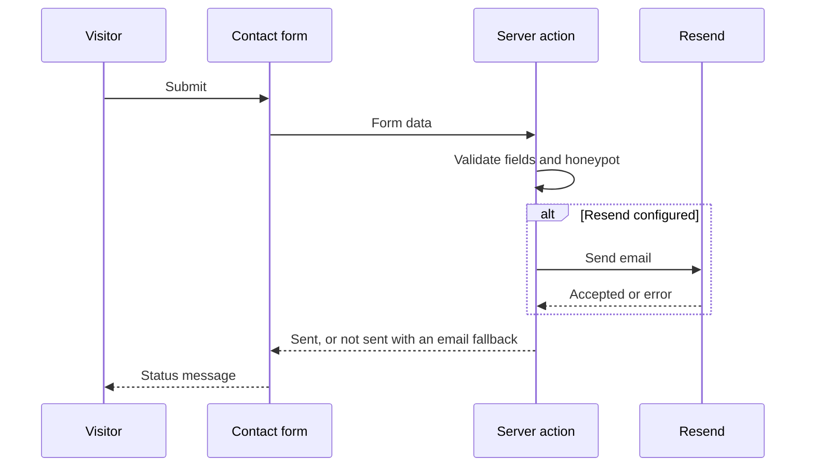

# System design

## Overview

The website is a statically generated Next.js 16 App Router site hosted on Vercel. Pages are prerendered at build time. The only code that runs per request is the contact form action, which validates a message and, when configured, sends it through Resend. The site has no database. Content lives in typed files under `src/content` and `src/lib/site.ts`.

## Routes

| Route | Rendering | Source |
| --- | --- | --- |
| `/` | Static | `src/app/page.tsx` |
| `/work` | Static | `src/app/work/page.tsx` |
| `/work/[slug]` | Prerendered for each case study | `src/app/work/[slug]/page.tsx` |
| `/services` | Static | `src/app/services/page.tsx` |
| `/services/[slug]` | Prerendered for each capability | `src/app/services/[slug]/page.tsx` |
| `/about` | Static | `src/app/about/page.tsx` |
| `/contact` | Static page with a server action for submissions | `src/app/contact/` |
| `/services/<legacy-slug>` | Permanent redirect (308) | `next.config.ts` |
| `/sitemap.xml`, `/robots.txt` | Generated at build | `src/app/sitemap.ts`, `src/app/robots.ts` |
| `/opengraph-image`, `/twitter-image` | Generated at build | `src/app/opengraph-image.tsx`, `src/app/twitter-image.tsx` |
| `/work/[slug]/opengraph-image` | Generated at build | `src/app/work/[slug]/opengraph-image.tsx` |
| Unknown URLs | 404 page | `src/app/not-found.tsx` |

## Feature folders

Route files in `src/app` stay thin. They choose the content and compose feature components. Each feature owns a folder under `src/components`:

| Folder | Owns |
| --- | --- |
| `layout` | Header, mobile menu, footer, active navigation link |
| `home` | Sections of the home page |
| `work` | Case study index and case study pages |
| `services` | Capability index and detail pages, FAQ |
| `about` | Company story, principles, leadership, stack |
| `contact` | Contact form, its states and delivery messages |
| `seo` | Structured data (JSON-LD) |
| `ui` | Shared primitives: containers, sections, buttons, headings, logo, browser and phone frames for screenshots, capability icons |

A feature imports from `ui`, `content` and `lib`. It does not import from another feature's folder. Content types and data live in `src/content`. Site-wide settings live in `src/lib/site.ts`, and small shared helpers (`cn`, `siteHost`, `pageMetadata`) live in `src/lib`.

## Content model

- **`site`** (`src/lib/site.ts`): name, short and former names, URL, email, description, tagline, postal address, navigation and the main call to action.
- **`CaseStudy` and `caseStudies`** (`src/content/work.ts`): slug, client, sector, summary, challenge, what we built, platforms, stack, highlights, status, two screenshots with alt text and an accent colour. Helpers: `getCaseStudy(slug)` and `caseStudySlugs()`.
- **`Capability` and `capabilities`** (`src/content/services.ts`): slug, title, short and full summary, icon name, deliverables, stack, related case studies, FAQ. Helpers: `getCapability(slug)` and `capabilitySlugs()`.
- **`legacyServiceRedirects`** (`src/content/services.ts`): old service slugs mapped to current capability slugs. `next.config.ts` turns each entry into a permanent redirect.

A capability lists the case studies it relates to through `CaseSlug`, so renaming a case study slug is a type error until every reference is updated.

## Design tokens

Tokens are Tailwind v4 theme values in `src/app/globals.css`. There is no separate Tailwind config file.

- **Colours**: `ink`, `paper`, `surface`, `muted` and `line`, plus the `forest` (100 to 950) and `gold` (100 to 600) scales.
- **Type**: `font-sans` (Geist), `font-mono` (Geist Mono) and `font-serif` (Instrument Serif, used for one accent phrase in a headline). The `display` sizes use tight tracking. Headings balance their line breaks.
- **Layout**: a `page` container width of 77.5rem, the radius scale and the `soft`, `lift` and `glow` shadows.
- **Texture**: `texture-glow`, `texture-circuit`, `texture-grain` and `texture-fade` give dark sections their background.
- **Motion**: CSS only. Scroll reveals use `animation-timeline: view()` inside `@supports`, so content stays visible in browsers without it. `prefers-reduced-motion` turns animation off.

## Contact delivery

- Validation runs on the server. Field errors come back to the form, and the visitor's typed values stay in place.
- A hidden honeypot field and a minimum time on the form catch most bots.
- Success is reported only when Resend accepts the message. Otherwise the visitor sees that the message was not sent and gets a prefilled email to the company address.
- Nothing is stored. A message exists only in the delivery email.

## SEO and social previews

- `metadataBase` comes from `site.url` in the root layout. Each page builds its title, description, canonical link and share cards with `pageMetadata` in `src/lib/metadata.ts`, so every page points at a generated preview image.
- `src/app/sitemap.ts` lists the home page, the index pages, every case study and every capability. The last-modified date is a fixed value in the file.
- `src/app/robots.ts` allows all crawlers and points them to the sitemap.
- Social preview images are generated at build time with `next/og` at 1200 by 630. The root image and its Twitter twin show the wordmark and tagline. Each case study image shows its name, sector and summary. All three read the brand mark from `public/brand/fit-mark.png`.
- Structured data: `src/components/seo/structured-data.tsx` exports `OrganizationJsonLd` and `WebSiteJsonLd`, rendered from the root layout. The JSON output escapes `<`, so a value cannot close the script tag early.

## Redirects, headers and caching

- `next.config.ts` sends each old service URL (`/services/<legacy>`) to its capability with a 308 response.
- `vercel.json` sets security headers on every route: `X-Content-Type-Options`, `X-Frame-Options`, `X-XSS-Protection`, `Referrer-Policy` and `Permissions-Policy`. Static image files get a one-year cache lifetime.

## Error handling

- `not-found.tsx` renders the 404 page inside the root layout, so the header and footer stay.
- `error.tsx` catches errors inside a page. Its "Try again" button re-fetches and re-renders the page with `unstable_retry`. When Next supplies an error reference, the page shows it.
- `global-error.tsx` replaces the root layout when the layout itself fails. It renders its own HTML with inline styles, so it does not depend on the global stylesheet or fonts.

## Accessibility and performance

- Every page has one `h1` inside `<main id="main-content">`. The root layout provides a skip link to it.
- Focus rings use the gold outline from `globals.css`.
- Pages render on the server. Client components are small leaves: the mobile menu, the active navigation link and the contact form.
- Raster images go through `next/image` with explicit sizes.

## Quality checks

- `pnpm lint` runs ESLint with the Next.js rules.
- `pnpm exec tsc --noEmit` type-checks the project.
- `pnpm build` prerenders every route and fails on errors.

## Known limits

- Social preview images use the default font in `next/og`. Geist is not embedded in them.
- The brand mark is a 313 KB PNG. Each social image embeds it as base64, so a smaller export of the mark would make those routes lighter.
