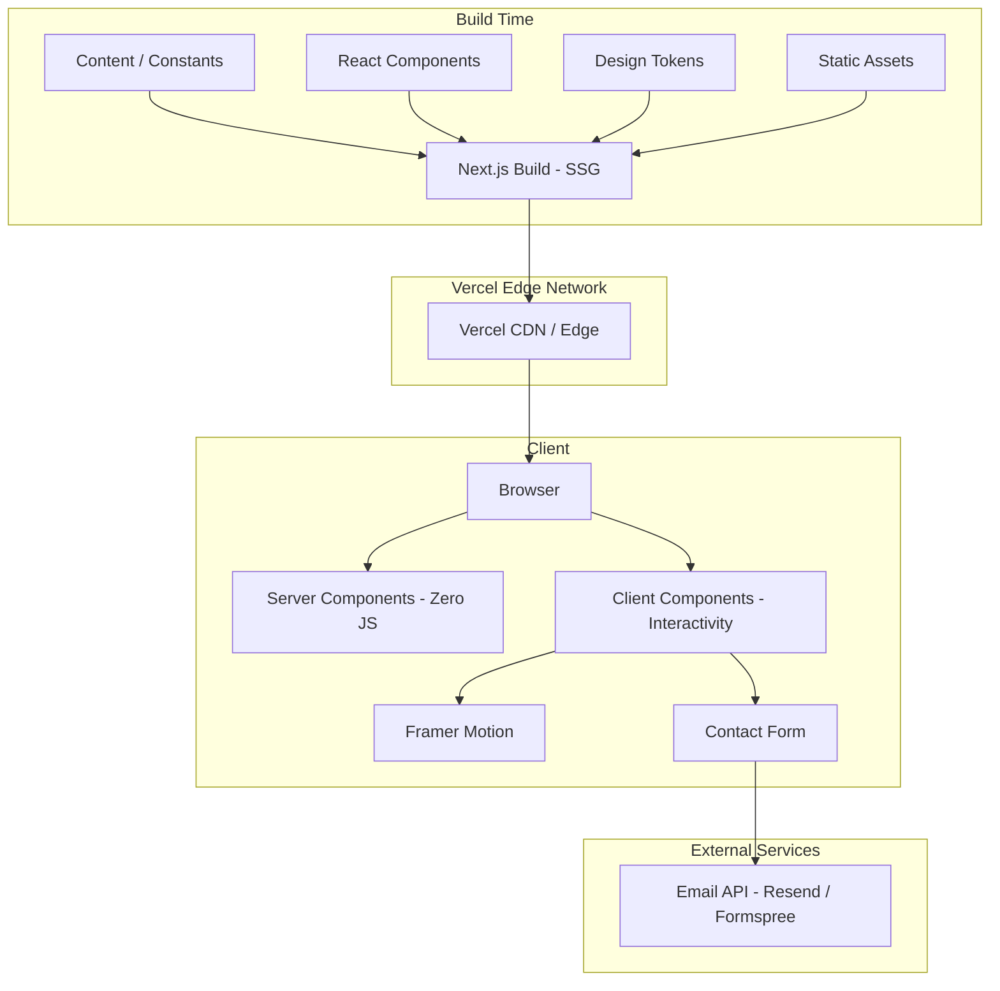
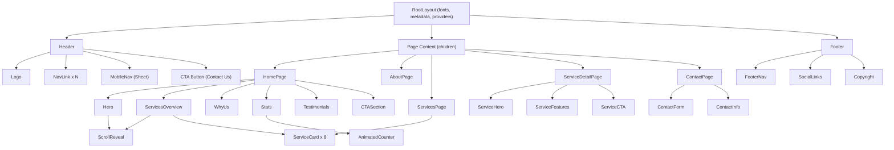
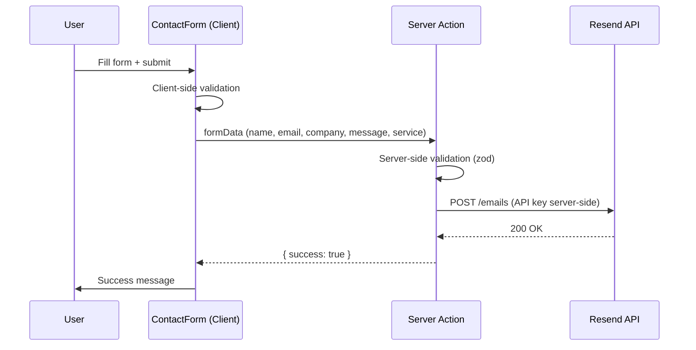

# System Architecture: Fundamental IT Solutions Website

## Overview

A statically-generated marketing website built with Next.js 15 (App Router) and deployed on Vercel. The site presents Fundamental IT Solutions' service offerings, company story, and contact information. All pages are pre-rendered at build time (SSG) with no runtime database or API dependencies. The architecture prioritizes performance (sub-2s LCP), SEO, and maintainability.

## Architecture Diagram



## Tech Stack

| Layer | Technology | Rationale |
|---|---|---|
| Framework | Next.js 15 (App Router) | SSG, RSC, image optimization, metadata API |
| Styling | Tailwind CSS v4 | Utility-first, design tokens via CSS variables, tree-shaking |
| UI Components | shadcn/ui | Accessible, unstyled primitives, copy-paste ownership |
| Animation | Framer Motion | Declarative animations, layout animations, scroll-triggered |
| Icons | Lucide React | Tree-shakeable, consistent stroke style |
| Font | Geist (Sans + Mono) | Vercel-optimized, modern geometric sans-serif |
| Linting | ESLint flat config + Prettier | Standard quality gates |
| Package Manager | pnpm | Fast, disk-efficient, strict by default |
| Deployment | Vercel | Zero-config Next.js hosting, edge CDN, analytics |

---

## Project Folder Structure

```
fundamental-it-solutions/
├── public/
│   ├── images/
│   │   ├── logo.svg
│   │   ├── og-image.jpg            # Default Open Graph image (1200x630)
│   │   ├── hero/                    # Hero section images
│   │   └── services/                # Service-specific imagery
│   ├── fonts/                       # Self-hosted font files (if not using next/font)
│   └── favicon.ico
│
├── src/
│   ├── app/
│   │   ├── layout.tsx               # Root layout (html, body, fonts, global providers)
│   │   ├── page.tsx                 # Home page
│   │   ├── not-found.tsx            # Custom 404
│   │   ├── about/
│   │   │   └── page.tsx             # About page
│   │   ├── services/
│   │   │   ├── page.tsx             # Services overview
│   │   │   └── [slug]/
│   │   │       └── page.tsx         # Individual service detail
│   │   ├── contact/
│   │   │   └── page.tsx             # Contact page
│   │   ├── sitemap.ts               # Dynamic sitemap generation
│   │   └── robots.ts                # Robots.txt generation
│   │
│   ├── components/
│   │   ├── ui/                      # shadcn/ui primitives (button, card, input, etc.)
│   │   ├── layout/
│   │   │   ├── header.tsx           # Site header with navigation
│   │   │   ├── footer.tsx           # Site footer
│   │   │   ├── mobile-nav.tsx       # Mobile navigation drawer/sheet
│   │   │   └── nav-link.tsx         # Navigation link with active state
│   │   ├── sections/
│   │   │   ├── hero.tsx             # Hero banner section
│   │   │   ├── services-overview.tsx # Services grid/cards on home
│   │   │   ├── why-us.tsx           # Value proposition section
│   │   │   ├── stats.tsx            # Key numbers/metrics section
│   │   │   ├── testimonials.tsx     # Client testimonials
│   │   │   ├── cta-section.tsx      # Call-to-action banner
│   │   │   └── contact-form.tsx     # Contact form component
│   │   └── shared/
│   │       ├── section-header.tsx   # Reusable section title + subtitle
│   │       ├── service-card.tsx     # Service card used across pages
│   │       ├── animated-counter.tsx # Animated number counter
│   │       ├── scroll-reveal.tsx    # Scroll-triggered reveal wrapper
│   │       └── icon-box.tsx         # Icon with background container
│   │
│   ├── lib/
│   │   ├── constants.ts            # Site-wide constants (company name, contact info)
│   │   ├── metadata.ts             # Shared metadata helpers
│   │   ├── services-data.ts        # Service definitions (name, slug, description, icon)
│   │   └── navigation.ts           # Navigation link definitions
│   │
│   ├── styles/
│   │   └── globals.css             # Tailwind directives, CSS custom properties, base styles
│   │
│   └── types/
│       └── index.ts                # Shared TypeScript types
│
├── docs/
│   └── architecture/
│       └── system-design.md         # This document
│
├── next.config.ts
├── tailwind.config.ts
├── tsconfig.json
├── eslint.config.mjs
├── package.json
├── pnpm-lock.yaml
└── .env.local                       # Contact form API key (if using external service)
```

---

## Routing Architecture

All routes use Next.js App Router with static generation (`generateStaticParams` for dynamic segments).

| Route | Page | Generation | Description |
|---|---|---|---|
| `/` | Home | SSG | Landing page with hero, services overview, stats, CTA |
| `/about` | About | SSG | Company story, mission, team, values |
| `/services` | Services | SSG | All services grid with brief descriptions |
| `/services/[slug]` | Service Detail | SSG (`generateStaticParams`) | Deep-dive per service |
| `/contact` | Contact | SSG (form is client) | Contact form + company info |
| `/sitemap.xml` | Sitemap | Build-time generated | SEO sitemap |
| `/robots.txt` | Robots | Build-time generated | Crawler directives |

### Service Slugs (8 services)

| Service | Slug |
|---|---|
| IT Consulting | `it-consulting` |
| Software Development | `software-development` |
| AI/ML Solutions | `ai-ml-solutions` |
| Data Analytics | `data-analytics` |
| Cloud Services | `cloud-services` |
| Cybersecurity | `cybersecurity` |
| Digital Transformation | `digital-transformation` |
| DevOps | `devops` |

### Static Generation Strategy

```typescript
// src/app/services/[slug]/page.tsx
export function generateStaticParams() {
  return services.map((service) => ({ slug: service.slug }));
}
```

All pages are fully static. The contact form uses a client component that submits to an external email service (Resend API or Formspree) via a Next.js Route Handler or direct client-side POST.

---

## Component Hierarchy



### Server vs Client Component Boundary

**Server Components (default, zero JS shipped):**
- All page components (`page.tsx`)
- Layout components (header structure, footer)
- Section wrappers (hero, services-overview, why-us)
- Static content rendering

**Client Components (`"use client"`):**
- `mobile-nav.tsx` -- requires state for open/close
- `contact-form.tsx` -- form state, validation, submission
- `scroll-reveal.tsx` -- Framer Motion intersection observer
- `animated-counter.tsx` -- number animation on scroll
- `nav-link.tsx` -- `usePathname()` for active state
- Any component using Framer Motion animations

**Rule:** Keep client components as leaf nodes. Wrap only the interactive part in `"use client"`, pass server-rendered content as children.

---

## Design Token System

All design tokens are defined as CSS custom properties in `globals.css` and consumed via Tailwind CSS v4 theme configuration.

### Color Palette

```css
/* src/styles/globals.css */
@theme {
  --color-primary-50: #e8f0f5;
  --color-primary-100: #c5d9e5;
  --color-primary-200: #9fbfd3;
  --color-primary-300: #7aa5c0;
  --color-primary-400: #5e91b2;
  --color-primary-500: #4380a5;
  --color-primary-600: #336d93;
  --color-primary-700: #1A5276;   /* Brand primary -- #1A5276 */
  --color-primary-800: #123b55;
  --color-primary-900: #0b2639;
  --color-primary-950: #06151f;

  --color-accent-400: #2ecc71;    /* Success / accent green */
  --color-accent-500: #27ae60;

  --color-neutral-50: #f8fafc;
  --color-neutral-100: #f1f5f9;
  --color-neutral-200: #e2e8f0;
  --color-neutral-300: #cbd5e1;
  --color-neutral-400: #94a3b8;
  --color-neutral-500: #64748b;
  --color-neutral-600: #475569;
  --color-neutral-700: #334155;
  --color-neutral-800: #1e293b;
  --color-neutral-900: #0f172a;
  --color-neutral-950: #020617;
}
```

**Usage pattern:**
- Primary 700 (`#1A5276`): Buttons, links, header background, key accents
- Primary 800-950: Dark backgrounds, hover states, footer
- Primary 50-200: Light backgrounds, cards, subtle tints
- Neutral scale: Body text, borders, secondary backgrounds
- Accent green: Success states, highlight metrics

### Typography Scale

```css
@theme {
  --font-sans: 'Geist', system-ui, -apple-system, sans-serif;
  --font-mono: 'Geist Mono', ui-monospace, monospace;

  /* Type scale (1.250 ratio - Major Third) */
  --text-xs: 0.75rem;      /* 12px */
  --text-sm: 0.875rem;     /* 14px */
  --text-base: 1rem;       /* 16px */
  --text-lg: 1.125rem;     /* 18px */
  --text-xl: 1.25rem;      /* 20px */
  --text-2xl: 1.5rem;      /* 24px */
  --text-3xl: 1.875rem;    /* 30px */
  --text-4xl: 2.25rem;     /* 36px */
  --text-5xl: 3rem;        /* 48px - Section headers */
  --text-6xl: 3.75rem;     /* 60px - Hero headline */
  --text-7xl: 4.5rem;      /* 72px - Hero headline (desktop) */
}
```

### Spacing Scale

Uses Tailwind's default 4px base (`--spacing: 0.25rem`). Key semantic spacing:

| Token | Value | Usage |
|---|---|---|
| `section-y` | `py-20 lg:py-28` | Vertical padding between page sections |
| `container` | `max-w-7xl mx-auto px-4 sm:px-6 lg:px-8` | Content container |
| `card-padding` | `p-6 lg:p-8` | Card internal padding |
| `stack-sm` | `space-y-4` | Tight vertical stack (form fields) |
| `stack-md` | `space-y-8` | Medium vertical stack (card groups) |
| `stack-lg` | `space-y-16` | Large vertical stack (page sections) |

### Border Radius

```css
@theme {
  --radius-sm: 0.375rem;   /* 6px - buttons, inputs */
  --radius-md: 0.5rem;     /* 8px - cards */
  --radius-lg: 0.75rem;    /* 12px - large cards, modals */
  --radius-xl: 1rem;       /* 16px - hero cards */
  --radius-full: 9999px;   /* pills, avatars */
}
```

---

## Shared Layout Architecture

### Root Layout (`src/app/layout.tsx`)

```typescript
import { Geist, Geist_Mono } from "next/font/google";
import { Header } from "@/components/layout/header";
import { Footer } from "@/components/layout/footer";
import "@/styles/globals.css";

const geistSans = Geist({ subsets: ["latin"], variable: "--font-sans" });
const geistMono = Geist_Mono({ subsets: ["latin"], variable: "--font-mono" });

export const metadata: Metadata = {
  metadataBase: new URL("https://fundamentalitsolutions.com"),
  title: {
    default: "Fundamental IT Solutions | Enterprise IT Services & Consulting",
    template: "%s | Fundamental IT Solutions",
  },
  description: "Transform your business with expert IT consulting, AI/ML solutions, cloud services, and digital transformation. Trusted by enterprises worldwide.",
  openGraph: {
    type: "website",
    locale: "en_US",
    siteName: "Fundamental IT Solutions",
    images: [{ url: "/images/og-image.jpg", width: 1200, height: 630 }],
  },
  twitter: {
    card: "summary_large_image",
  },
  robots: {
    index: true,
    follow: true,
  },
};

export default function RootLayout({ children }: { children: React.ReactNode }) {
  return (
    <html lang="en" className={`${geistSans.variable} ${geistMono.variable}`}>
      <body className="font-sans antialiased bg-white text-neutral-900">
        <Header />
        <main>{children}</main>
        <Footer />
      </body>
    </html>
  );
}
```

### Header Behavior

- **Desktop (>= 1024px):** Horizontal nav links + "Contact Us" CTA button
- **Mobile (< 1024px):** Logo + hamburger icon, opens a slide-in sheet (shadcn/ui Sheet)
- **Scroll behavior:** Transparent on hero, transitions to solid background with subtle backdrop blur on scroll (client component for scroll detection)
- **Sticky:** `position: sticky; top: 0;` with `z-50`

### Footer Structure

- 4-column grid: Company info, Services links, Quick links, Contact info
- Social media icons row
- Copyright bar
- All server-rendered (no interactivity)

---

## Performance Architecture

### Image Optimization

- Use `next/image` for all images -- automatic WebP/AVIF, responsive srcsets, lazy loading
- Hero images: `priority` prop, preloaded, sized for LCP
- Service icons: SVG (inline or Lucide components) -- zero network requests
- OG image: Pre-generated 1200x630 JPG in `/public/images/`

### Font Loading

```typescript
// next/font/google -- automatic font optimization
// - Subsets: latin only
// - Display: swap (FOUT over FOIT)
// - Self-hosted at build time -- no Google Fonts runtime requests
const geist = Geist({ subsets: ["latin"], display: "swap" });
```

### Code Splitting

- **Automatic:** Next.js splits per-route by default
- **Dynamic imports:** Heavy client components (Framer Motion animations) use `next/dynamic` with `ssr: false` where appropriate
- **Server Components:** Ship zero JavaScript for static content sections
- **Bundle target:** < 100KB first-load JS (excluding images)

### Static Generation

- `output: 'export'` NOT used -- we leverage Vercel's SSG + ISR infrastructure
- All pages generate at build time
- `generateStaticParams` for service detail pages
- Vercel CDN serves pre-rendered HTML at the edge

### Performance Budgets

| Metric | Target |
|---|---|
| LCP | < 2.0s |
| FID/INP | < 100ms |
| CLS | < 0.1 |
| First Load JS | < 100KB |
| Total page weight | < 500KB |
| Lighthouse Performance | > 95 |

---

## SEO Architecture

### Metadata Strategy

Each page exports a `metadata` object or `generateMetadata` function:

```typescript
// src/app/services/[slug]/page.tsx
export function generateMetadata({ params }: { params: { slug: string } }): Metadata {
  const service = getServiceBySlug(params.slug);
  return {
    title: service.title,
    description: service.metaDescription,
    openGraph: {
      title: service.title,
      description: service.metaDescription,
      images: [{ url: service.ogImage || "/images/og-image.jpg" }],
    },
  };
}
```

### Sitemap Generation

```typescript
// src/app/sitemap.ts
export default function sitemap(): MetadataRoute.Sitemap {
  const services = getAllServices();
  return [
    { url: "https://fundamentalitsolutions.com", lastModified: new Date(), priority: 1.0 },
    { url: "https://fundamentalitsolutions.com/about", lastModified: new Date(), priority: 0.8 },
    { url: "https://fundamentalitsolutions.com/services", lastModified: new Date(), priority: 0.9 },
    ...services.map((s) => ({
      url: `https://fundamentalitsolutions.com/services/${s.slug}`,
      lastModified: new Date(),
      priority: 0.7,
    })),
    { url: "https://fundamentalitsolutions.com/contact", lastModified: new Date(), priority: 0.8 },
  ];
}
```

### Structured Data (JSON-LD)

Embed JSON-LD in the root layout and service detail pages:

```typescript
// Root layout -- Organization schema
const organizationSchema = {
  "@context": "https://schema.org",
  "@type": "Organization",
  name: "Fundamental IT Solutions",
  url: "https://fundamentalitsolutions.com",
  logo: "https://fundamentalitsolutions.com/images/logo.svg",
  contactPoint: {
    "@type": "ContactPoint",
    contactType: "customer service",
    // phone, email from constants
  },
  sameAs: [/* social media URLs */],
};

// Service pages -- Service schema
const serviceSchema = {
  "@context": "https://schema.org",
  "@type": "Service",
  name: service.title,
  description: service.description,
  provider: { "@type": "Organization", name: "Fundamental IT Solutions" },
};
```

### Robots Configuration

```typescript
// src/app/robots.ts
export default function robots(): MetadataRoute.Robots {
  return {
    rules: { userAgent: "*", allow: "/" },
    sitemap: "https://fundamentalitsolutions.com/sitemap.xml",
  };
}
```

---

## Contact Form Architecture

The contact form is the only interactive data-submission feature on the site.

### Approach: Server Action + External Email Service



- **Client validation:** Required fields, email format (HTML5 + light JS)
- **Server validation:** Zod schema in the server action
- **Email delivery:** Resend (or Formspree as fallback) -- API key stays server-side
- **Honeypot field:** Hidden field for basic bot prevention
- **Rate limiting:** Vercel Edge Middleware or simple in-memory throttle

### Form Fields

| Field | Type | Required | Validation |
|---|---|---|---|
| Name | text | Yes | 2-100 chars |
| Email | email | Yes | Valid email |
| Company | text | No | Max 100 chars |
| Service Interest | select | No | Enum of service slugs |
| Message | textarea | Yes | 10-2000 chars |

---

## Animation Strategy

Animations use Framer Motion, applied sparingly for polish without sacrificing performance.

### Scroll-Triggered Reveals

```typescript
// src/components/shared/scroll-reveal.tsx
"use client";

import { motion } from "framer-motion";

interface ScrollRevealProps {
  children: React.ReactNode;
  delay?: number;
}

export function ScrollReveal({ children, delay = 0 }: ScrollRevealProps) {
  return (
    <motion.div
      initial={{ opacity: 0, y: 20 }}
      whileInView={{ opacity: 1, y: 0 }}
      viewport={{ once: true, margin: "-100px" }}
      transition={{ duration: 0.5, delay, ease: "easeOut" }}
    >
      {children}
    </motion.div>
  );
}
```

### Animation Patterns

| Element | Animation | Trigger |
|---|---|---|
| Section content | Fade up (opacity + translateY) | Scroll into viewport |
| Service cards | Staggered fade up (0.1s delay each) | Scroll into viewport |
| Stat counters | Count from 0 to value | Scroll into viewport |
| Header | Background opacity transition | Scroll position > 50px |
| Page transitions | Subtle fade | Route change |
| CTA buttons | Scale on hover (1.02) | Hover |
| Mobile nav | Slide in from right | Menu toggle |

### Performance Rules

- `viewport: { once: true }` -- animate once, don't re-trigger
- Prefer `transform` and `opacity` animations (GPU-composited, no layout thrash)
- No animation on initial page load except hero (keep LCP fast)
- Respect `prefers-reduced-motion` -- disable animations for accessibility

---

## Data Layer

No database. All content is co-located as TypeScript constants.

### Service Data Model

```typescript
// src/lib/services-data.ts
export interface Service {
  slug: string;
  title: string;
  shortDescription: string;    // For cards on home/services page
  fullDescription: string;     // For detail page
  icon: string;                // Lucide icon name
  features: string[];          // Key features/bullet points
  metaDescription: string;     // SEO meta
}

export const services: Service[] = [
  {
    slug: "it-consulting",
    title: "IT Consulting",
    shortDescription: "Strategic technology guidance to align IT with your business goals.",
    fullDescription: "...",
    icon: "lightbulb",
    features: ["Technology Assessment", "IT Strategy", "Digital Roadmap", "Vendor Selection"],
    metaDescription: "Expert IT consulting services...",
  },
  // ... 7 more services
];

export function getServiceBySlug(slug: string): Service | undefined {
  return services.find((s) => s.slug === slug);
}

export function getAllServices(): Service[] {
  return services;
}
```

### Navigation Data

```typescript
// src/lib/navigation.ts
export interface NavItem {
  label: string;
  href: string;
}

export const mainNavItems: NavItem[] = [
  { label: "Home", href: "/" },
  { label: "About", href: "/about" },
  { label: "Services", href: "/services" },
  { label: "Contact", href: "/contact" },
];
```

### Site Constants

```typescript
// src/lib/constants.ts
export const SITE_CONFIG = {
  name: "Fundamental IT Solutions",
  tagline: "Transforming Businesses Through Technology",
  domain: "fundamentalitsolutions.com",
  email: "info@fundamentalitsolutions.com",
  phone: "+1 (XXX) XXX-XXXX",
  address: {
    street: "...",
    city: "...",
    state: "...",
    zip: "...",
    country: "...",
  },
  social: {
    linkedin: "https://linkedin.com/company/fundamental-it-solutions",
    twitter: "https://twitter.com/fundamental_it",
  },
} as const;
```

---

## How to Test

### Development
```bash
pnpm dev          # Start dev server at localhost:3000
```

### Quality Checks
```bash
pnpm build        # Full production build -- catches all SSG errors
pnpm lint         # ESLint
pnpm type-check   # tsc --noEmit
```

### Performance Verification
1. Run `pnpm build` and check bundle analysis output
2. Run Lighthouse on the production build (`pnpm start`)
3. Verify all pages are statically generated (check `.next/server/app/` for `.html` files)
4. Test Core Web Vitals with Chrome DevTools Performance tab

### SEO Verification
1. Check `<head>` for correct title, description, OG tags per page
2. Visit `/sitemap.xml` and `/robots.txt`
3. Validate structured data at https://validator.schema.org/
4. Check mobile rendering with Chrome DevTools device emulation

### Accessibility
1. Lighthouse accessibility audit (target: 100)
2. Keyboard navigation through all interactive elements
3. Screen reader testing (VoiceOver on macOS)
4. Color contrast verification (primary-700 on white passes WCAG AA)

### Cross-Browser / Device
1. Chrome, Safari, Firefox (latest)
2. iOS Safari, Chrome Android
3. Responsive breakpoints: 375px, 768px, 1024px, 1440px

---

## Scaling Considerations

This is a static marketing site, so traditional scaling concerns (database, API throughput) do not apply. What matters:

| Concern | Current Design | At 10x Traffic |
|---|---|---|
| Page load | Vercel CDN (edge-cached static HTML) | No change needed -- CDN scales infinitely |
| Contact form | Server action + Resend API | Add rate limiting, consider queue for email delivery |
| Content updates | Edit TypeScript constants, redeploy | Consider headless CMS (Sanity/Contentful) if marketing team needs self-serve |
| Blog / Resources | Not in scope | Add MDX-based blog with `@next/mdx` or headless CMS |
| Internationalization | English only | Add `next-intl` with locale routing |
| Analytics | Vercel Analytics (built-in) | Add Google Analytics 4 or Plausible if deeper insights needed |

### Future Evolution Path

1. **Phase 1 (Current):** Static marketing site with 4 page groups
2. **Phase 2:** Add blog/resources section (MDX or CMS)
3. **Phase 3:** Client portal / case studies (may need auth)
4. **Phase 4:** Multi-language support

---

## Architectural Decisions

### ADR-001: Static Generation Over SSR

**Status:** Accepted

**Context:** This is a marketing site with no user-specific content. All pages show the same content to every visitor.

**Decision:** Use SSG (Static Site Generation) for all pages. No SSR, no ISR needed for the initial launch.

**Consequences:**
- Positive: Fastest possible TTFB (HTML served from CDN edge), zero server costs, maximum reliability
- Positive: Perfect Lighthouse scores achievable
- Negative: Content updates require a rebuild + deploy (acceptable for a company-managed site)

### ADR-002: Tailwind CSS v4 + shadcn/ui Over Component Library

**Status:** Accepted

**Context:** Need a styling approach that supports custom design tokens, is performant, and gives full control over the visual design.

**Decision:** Use Tailwind CSS v4 for utility-based styling with CSS custom property theming. Use shadcn/ui for accessible component primitives (Button, Card, Sheet, Input) that we copy into the project and own.

**Consequences:**
- Positive: Full design control, no fighting a component library's opinions
- Positive: Tree-shaking eliminates unused styles
- Positive: shadcn/ui components are accessible out of the box (Radix UI primitives)
- Negative: More initial setup than a pre-built UI library
- Trade-off: Team must maintain copied components (acceptable for a small component set)

### ADR-003: Content as TypeScript Constants

**Status:** Accepted

**Context:** The site has a fixed set of pages and services. Content changes are infrequent and managed by the development team.

**Decision:** Store all content (service descriptions, company info, navigation) as typed TypeScript constants in `src/lib/`. No CMS, no markdown files, no database.

**Consequences:**
- Positive: Type-safe content, zero external dependencies, fast builds
- Positive: Content co-located with code -- easy to find and update
- Negative: Non-technical stakeholders cannot edit content without developer involvement
- Mitigation: Can migrate to headless CMS later if needed (the data interfaces stay the same)

### ADR-004: Framer Motion for Animations

**Status:** Accepted

**Context:** Modern marketing sites need tasteful animations for perceived quality. Need a library that works with React Server Components architecture.

**Decision:** Use Framer Motion for scroll-triggered reveals, hover effects, and page transitions. Keep animations in dedicated client components to preserve server component benefits.

**Consequences:**
- Positive: Declarative API, excellent DX, great performance with GPU-composited animations
- Positive: Built-in `whileInView`, layout animations, gesture support
- Negative: Adds ~30KB to client bundle (acceptable given the animation quality)
- Risk: Must be careful to keep Framer Motion in client components only
